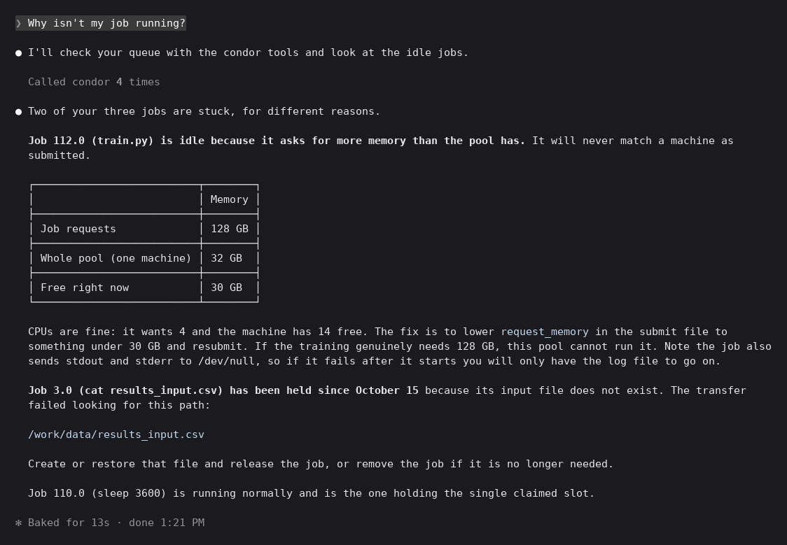
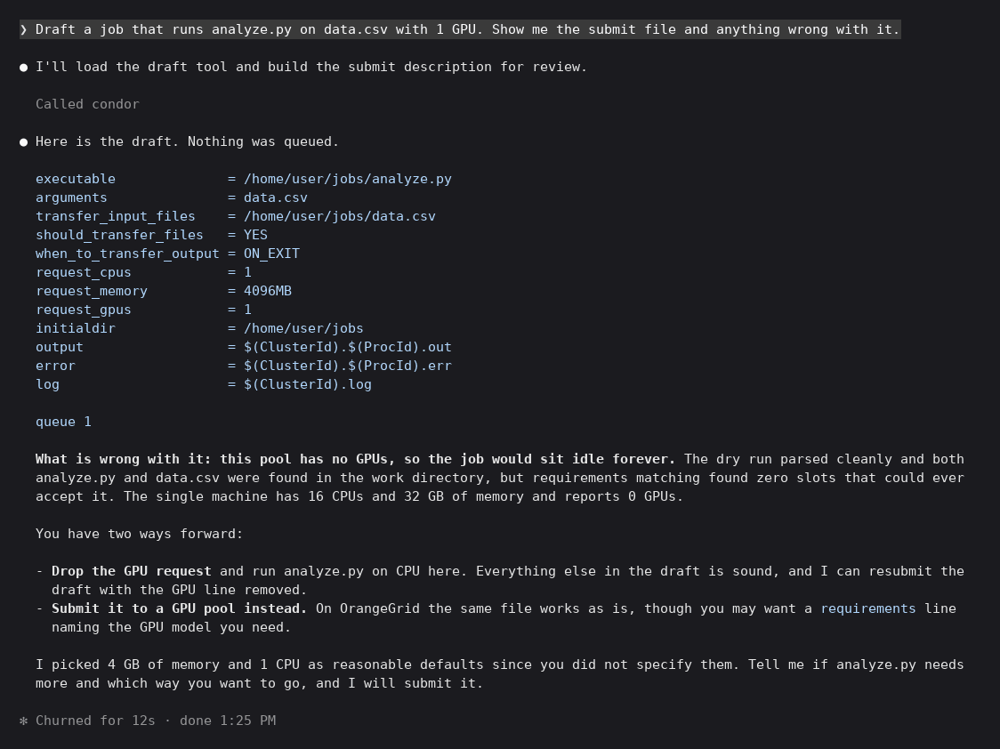
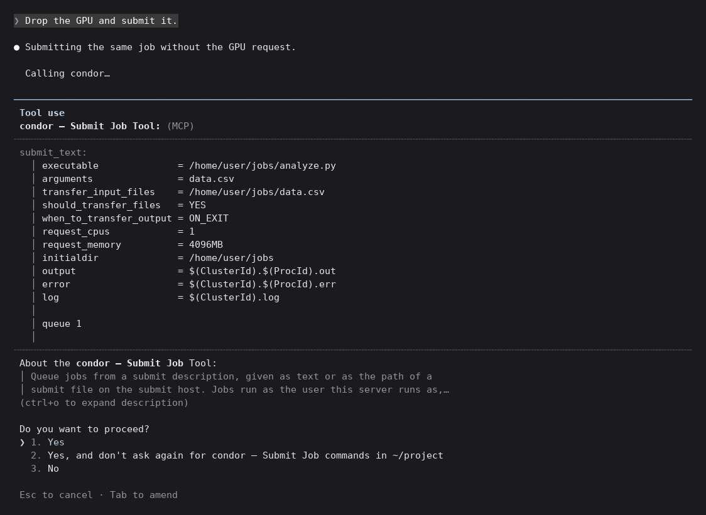
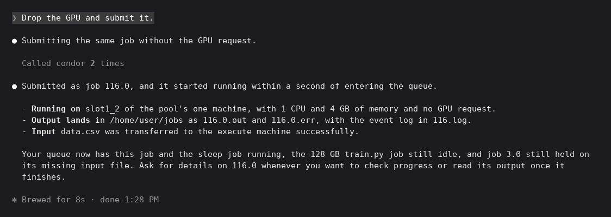

# condor-mcp

An [MCP](https://modelcontextprotocol.io/) server that puts an
[HTCondor](https://htcondor.readthedocs.io/en/latest/) pool behind a natural-language
interface. It lets an AI assistant answer questions like "why isn't my job running?" by
calling tools that query the pool through the
[htcondor2 Python bindings](https://htcondor.readthedocs.io/en/latest/apis/python-bindings/).

Built with [FastMCP](https://gofastmcp.com/) ([repo](https://github.com/jlowin/fastmcp)) for Syracuse University's OrangeGrid
cluster. Example submit files to test against live in
[OrangeGridExamples](https://github.com/SyracuseUniversity/OrangeGridExamples).

## Example session

These are from a Claude Code session on a one-machine
[htcondor/mini](https://hub.docker.com/r/htcondor/mini) dev pool, with a few jobs queued
ahead of time: one running, one that will never match because it asks for 128 GB on a
32 GB machine, and one on hold because its input file doesn't exist. Any MCP client
works; Claude Code is shown because it runs on the submit host over stdio.

Asking why a job is stuck:



<details>
<summary>Transcript</summary>

```text
❯ Why isn't my job running?

● I'll check your queue with the condor tools and look at the idle jobs.

  Called condor 4 times

● Two of your three jobs are stuck, for different reasons.

  Job 112.0 (train.py) is idle because it asks for more memory than the pool has. It will never match a machine as
  submitted.

  ┌──────────────────────────┬────────┐
  │                          │ Memory │
  ├──────────────────────────┼────────┤
  │ Job requests             │ 128 GB │
  ├──────────────────────────┼────────┤
  │ Whole pool (one machine) │ 32 GB  │
  ├──────────────────────────┼────────┤
  │ Free right now           │ 30 GB  │
  └──────────────────────────┴────────┘

  CPUs are fine: it wants 4 and the machine has 14 free. The fix is to lower request_memory in the submit file to
  something under 30 GB and resubmit. If the training genuinely needs 128 GB, this pool cannot run it. Note the job also
  sends stdout and stderr to /dev/null, so if it fails after it starts you will only have the log file to go on.

  Job 3.0 (cat results_input.csv) has been held since October 15 because its input file does not exist. The transfer
  failed looking for this path:

  /work/data/results_input.csv

  Create or restore that file and release the job, or remove the job if it is no longer needed.

  Job 110.0 (sleep 3600) is running normally and is the one holding the single claimed slot.

✻ Baked for 13s · done 1:21 PM
```

</details>

Drafting a job. Nothing is queued yet; `draft_submit` builds the file and checks it
against the pool, which here has no GPUs:



<details>
<summary>Transcript</summary>

```text
❯ Draft a job that runs analyze.py on data.csv with 1 GPU. Show me the submit file and anything wrong with it.

● I'll load the draft tool and build the submit description for review.

  Called condor

● Here is the draft. Nothing was queued.

  executable              = /home/user/jobs/analyze.py
  arguments               = data.csv
  transfer_input_files    = /home/user/jobs/data.csv
  should_transfer_files   = YES
  when_to_transfer_output = ON_EXIT
  request_cpus            = 1
  request_memory          = 4096MB
  request_gpus            = 1
  initialdir              = /home/user/jobs
  output                  = $(ClusterId).$(ProcId).out
  error                   = $(ClusterId).$(ProcId).err
  log                     = $(ClusterId).log

  queue 1

  What is wrong with it: this pool has no GPUs, so the job would sit idle forever. The dry run parsed cleanly and both
  analyze.py and data.csv were found in the work directory, but requirements matching found zero slots that could ever
  accept it. The single machine has 16 CPUs and 32 GB of memory and reports 0 GPUs.

  You have two ways forward:

  - Drop the GPU request and run analyze.py on CPU here. Everything else in the draft is sound, and I can resubmit the
    draft with the GPU line removed.
  - Submit it to a GPU pool instead. On OrangeGrid the same file works as is, though you may want a requirements line
    naming the GPU model you need.

  I picked 4 GB of memory and 1 CPU as reasonable defaults since you did not specify them. Tell me if analyze.py needs
  more and which way you want to go, and I will submit it.

✻ Churned for 12s · done 1:25 PM
```

</details>

Submitting it. `submit_job` changes the queue, so Claude Code asks first and shows the
exact submit text it is about to send:



<details>
<summary>Transcript</summary>

```text
❯ Drop the GPU and submit it.

● Submitting the same job without the GPU request.

  Calling condor…

────────────────────────────────────────────────────────────────────────────────────────────────────────────────────────
 Tool use
 condor — Submit Job Tool: (MCP)
╌╌╌╌╌╌╌╌╌╌╌╌╌╌╌╌╌╌╌╌╌╌╌╌╌╌╌╌╌╌╌╌╌╌╌╌╌╌╌╌╌╌╌╌╌╌╌╌╌╌╌╌╌╌╌╌╌╌╌╌╌╌╌╌╌╌╌╌╌╌╌╌╌╌╌╌╌╌╌╌╌╌╌╌╌╌╌╌╌╌╌╌╌╌╌╌╌╌╌╌╌╌╌╌╌╌╌╌╌╌╌╌╌╌╌╌╌╌╌╌
 submit_text:
   │ executable              = /home/user/jobs/analyze.py
   │ arguments               = data.csv
   │ transfer_input_files    = /home/user/jobs/data.csv
   │ should_transfer_files   = YES
   │ when_to_transfer_output = ON_EXIT
   │ request_cpus            = 1
   │ request_memory          = 4096MB
   │ initialdir              = /home/user/jobs
   │ output                  = $(ClusterId).$(ProcId).out
   │ error                   = $(ClusterId).$(ProcId).err
   │ log                     = $(ClusterId).log
   │
   │ queue 1
   │
╌╌╌╌╌╌╌╌╌╌╌╌╌╌╌╌╌╌╌╌╌╌╌╌╌╌╌╌╌╌╌╌╌╌╌╌╌╌╌╌╌╌╌╌╌╌╌╌╌╌╌╌╌╌╌╌╌╌╌╌╌╌╌╌╌╌╌╌╌╌╌╌╌╌╌╌╌╌╌╌╌╌╌╌╌╌╌╌╌╌╌╌╌╌╌╌╌╌╌╌╌╌╌╌╌╌╌╌╌╌╌╌╌╌╌╌╌╌╌╌
 About the condor — Submit Job Tool:
 │ Queue jobs from a submit description, given as text or as the path of a
 │ submit file on the submit host. Jobs run as the user this server runs as,…
 (ctrl+o to expand description)

 Do you want to proceed?
 ❯ 1. Yes
   2. Yes, and don't ask again for condor — Submit Job commands in ~/project
   3. No

 Esc to cancel · Tab to amend
```

</details>

After approving:



<details>
<summary>Transcript</summary>

```text
❯ Drop the GPU and submit it.

● Submitting the same job without the GPU request.

  Called condor 2 times

● Submitted as job 116.0, and it started running within a second of entering the queue.

  - Running on slot1_2 of the pool's one machine, with 1 CPU and 4 GB of memory and no GPU request.
  - Output lands in /home/user/jobs as 116.0.out and 116.0.err, with the event log in 116.log.
  - Input data.csv was transferred to the execute machine successfully.

  Your queue now has this job and the sleep job running, the 128 GB train.py job still idle, and job 3.0 still held on
  its missing input file. Ask for details on 116.0 whenever you want to check progress or read its output once it
  finishes.

✻ Brewed for 8s · done 1:28 PM
```

</details>

## Requirements

- A submit host: a machine where `condor_q` works and that has an HTCondor config pointing
  at the pool. The server runs as the user whose jobs it should see, with that user's
  credentials. It does not need root.
- Python 3.12 or newer and [uv](https://docs.astral.sh/uv/). The HTCondor Python bindings
  are pulled in by `uv sync` and are pinned to match the pool's daemon version in
  [pyproject.toml](pyproject.toml). Change the pin if your pool runs something else.
  The bindings ship as Linux-only wheels, so `uv sync` fails on macOS and Windows; run
  the server on the submit host itself.

## Install

```sh
git clone https://github.com/samlanda12/condor-mcp.git
cd condor-mcp
uv sync
```

Check it can see the pool:

```sh
uv run python -c "import htcondor2 as h; print(h.Schedd().query(projection=['ClusterId'], limit=1))"
```

## Running it

The server speaks MCP over stdio. Point any MCP client at this command, run from the
repo directory:

```sh
uv run condor-mcp
```

For Claude Code, drop a `.mcp.json` in the repo root:

```json
{
  "mcpServers": {
    "condor": {
      "command": "uv",
      "args": ["run", "--directory", "/path/to/condor-mcp", "condor-mcp"]
    }
  }
}
```

Other clients take the same command and args in their own config format. Put any
`CONDOR_MCP_*` settings (below) in the client's `env` block.

## Tools

Jobs that have finished and left the queue are invisible to these tools; job history
comes in a later stage.

| Tool | What it answers |
| --- | --- |
| `job_details(cluster_id, proc_id=0)` | Everything about one job: status, where it runs, requested vs used resources, input/output files, and the hold reason in plain language if it is held. |
| `list_jobs(owner="me", status=None, limit=50)` | One line per job plus a count of the owner's jobs by status. `owner` is `me`, `all`, or a username. |
| `hold_reasons(owner="me")` | Every held job with HTCondor's message, the hold code, what the code means, and a tally by code. |
| `pool_status(detail=False)` | Machines, slots by state, CPUs / memory / GPUs total and available, GPUs by model, largest free CPU block. `detail=True` adds one row per slot. |
| `draft_submit(executable, arguments="", input_files=None, cpus=1, memory_mb=1024, gpus=0, queue=1, extra=None, ...)` | A submit file built from the fields, checked with `condor_submit -dry-run` and against the pool's slots, with warnings for a missing executable or input, a typo in `extra`, or a request no slot can fit. Queues nothing. |
| `submit_job(submit_text=None, submit_file=None, dry_run=False)` | Queues the jobs in a submit description, given as text (a draft the user approved) or as the path of a submit file on the submit host. Runs `condor_submit -dry-run` first and refuses on any error. `dry_run=True` returns the job ads instead of queuing. Submits to the first schedd in `CONDOR_MCP_SCHEDDS`. Returns the cluster id, job count, and one `list_jobs` row per job. |
| `hold_job(cluster_id, reason, proc_id=None)` | Puts a job on hold, or every job in the cluster if `proc_id` is omitted. A running job is stopped; it stays in the queue until released. The reason is recorded on the job. Returns each job's status before and after. |
| `release_job(cluster_id, reason, proc_id=None)` | Releases a held job back to idle so it can be matched again. A job whose hold cause is still present goes straight back on hold. Returns each job's status before and after. |
| `remove_job(cluster_id, reason, proc_id=None)` | Removes a job from the queue for good: a running job is killed, an idle or held one is dropped. No undo. Output already written stays on disk. |

### Read-only and write tools

`job_details`, `list_jobs`, `hold_reasons`, `pool_status`, and `draft_submit` are
read-only: `draft_submit` writes nothing and contacts no schedd. The rest change the queue
and are marked non-read-only in their MCP annotations so clients can ask the user before
calling them.

`submit_job` queues jobs as the user the server runs as. It refuses `include` lines, which
read files or run a shell command at submit time, and `queue ... |` statements, which run
one, along with a macro in the `queue` line or a second `queue` statement, which could
hide one.

`hold_job`, `release_job`, and `remove_job` act only on jobs owned by the configured user
(`CONDOR_MCP_USER`) and refuse anyone else's, before HTCondor's own permission check.
Each takes a reason, which HTCondor records on the job, and reports what changed; a job
already in the requested state is left alone. Calling one twice has the same effect as
calling it once. `remove_job` is the one tool marked destructive in its annotations: a
removed job cannot be brought back, only resubmitted.

## Configuration

With no settings the server uses the local HTCondor config: the default collector, the
local schedd, and the user it runs as. Override with environment variables. They are
read once at startup, and an empty value is the same as unset.

| Variable | Default | What it does |
| --- | --- | --- |
| `CONDOR_MCP_COLLECTOR` | from the HTCondor config | Collector to talk to, as `host[:port]`. |
| `CONDOR_MCP_SCHEDDS` | local schedd | Schedds to query, comma-separated. Results are tagged with the schedd name; `submit_job` uses the first. |
| `CONDOR_MCP_USER` | the user running the server | Who `owner="me"` refers to. |
| `CONDOR_MCP_SLOT_CONSTRAINT` | `True` | Only slots matching this ClassAd expression count in `pool_status`. |
| `CONDOR_MCP_JOB_ATTRS` | none | Extra job attributes to return, comma-separated. |
| `CONDOR_MCP_SLOT_ATTRS` | none | Extra slot attributes to return from `pool_status(detail=True)`, comma-separated. |
| `CONDOR_MCP_CALL_LOG` | off | File to log each tool call to. Handy during a demo. |
| `CONDOR_MCP_WORKDIR` | `~/condor-mcp-jobs` | Where drafted jobs run from (their `initialdir`) and where their log, stdout and stderr land, named after the job id. Relative paths in a draft are taken relative to it. Created at startup if missing. |

GPU attributes are always fetched. On a pool without GPUs they come back empty, which is
expected.

## Tests

The tests run against a live pool and need permission to submit. They submit a sleep job
and a job that goes on hold with a missing input file, wait for both, check every tool,
queue a third through `draft_submit` and `submit_job`, hold, release, and remove a fourth,
and remove only the jobs they submitted (tagged `CondorMcpTest`). Drafts and submitted
jobs use a work directory under the system temp dir. Don't run them against a production
schedd you don't own. They also assume a small development pool: a single execute machine
with no GPUs, as in the container below. On a bigger pool the server works but the
`pool_status` tests fail.

```sh
uv run pytest
```

## Developing

Any HTCondor pool you can submit to works for development, including a single-machine
one such as the [htcondor/mini](https://hub.docker.com/r/htcondor/mini) container. Whatever
you use, run the server and the tests inside it as a user allowed to submit.

Code layout: [classads.py](condor_mcp/classads.py) turns ClassAds into dicts and
holds the hold-code table, [pool.py](condor_mcp/pool.py) reads the settings, knows
where the pool is and wraps connection errors, [submit.py](condor_mcp/submit.py) builds
and checks submit files, [server.py](condor_mcp/server.py) defines the tools.
