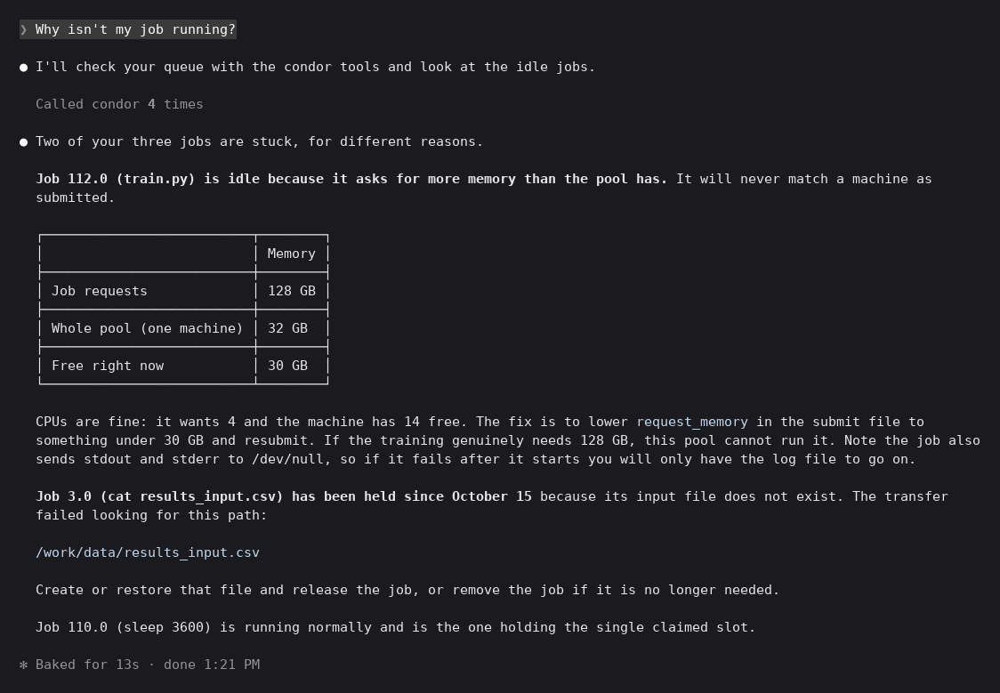
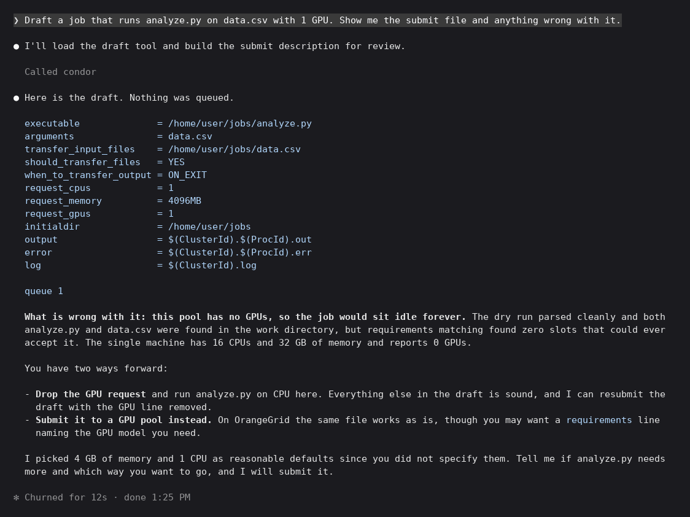
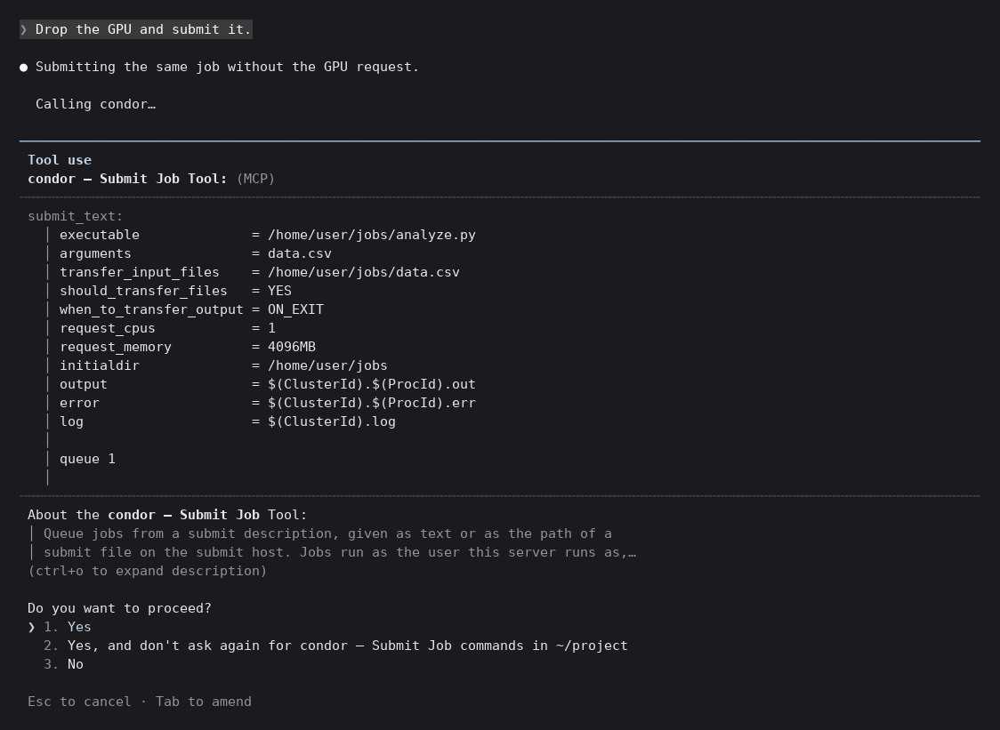
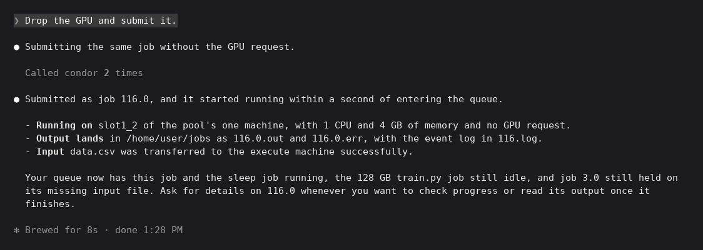
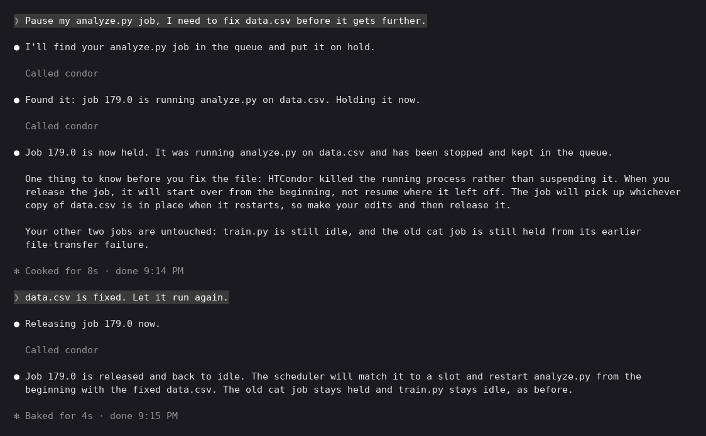
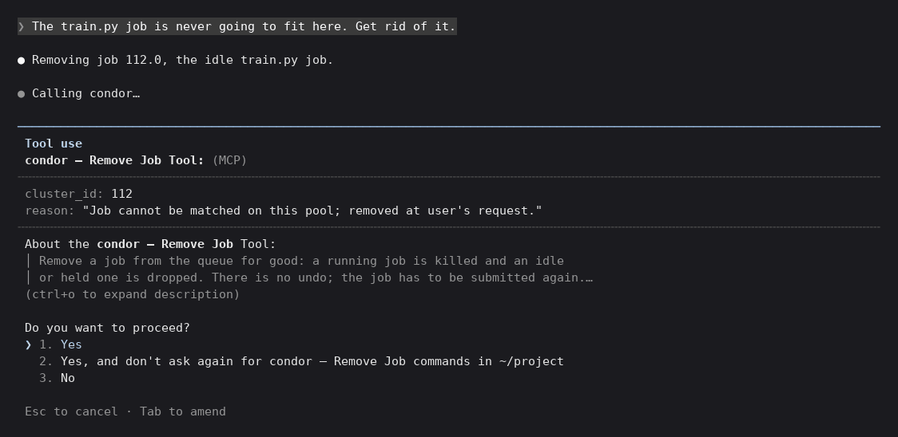

# Example session

This is the full flow, from diagnosing stuck jobs through drafting, submitting, holding,
releasing, and removing. It ran in Claude Code on a one-machine
[htcondor/mini](https://hub.docker.com/r/htcondor/mini) dev pool, with a few jobs queued
ahead of time: one running, one that will never match because it asks for 128 GB on a
32 GB machine, and one on hold because its input file doesn't exist. Any MCP client
works.

## Diagnosing a stuck job

The user asks why a job isn't running:



<details>
<summary>Transcript</summary>

```text
❯ Why isn't my job running?

● I'll check your queue with the condor tools and look at the idle jobs.

  Called condor 4 times

● Two of your three jobs are stuck, for different reasons.

  Job 112.0 (train.py) is idle because it asks for more memory than the pool has. It will never match a machine as
  submitted.

  ┌──────────────────────────┬────────┐
  │                          │ Memory │
  ├──────────────────────────┼────────┤
  │ Job requests             │ 128 GB │
  ├──────────────────────────┼────────┤
  │ Whole pool (one machine) │ 32 GB  │
  ├──────────────────────────┼────────┤
  │ Free right now           │ 30 GB  │
  └──────────────────────────┴────────┘

  CPUs are fine: it wants 4 and the machine has 14 free. The fix is to lower request_memory in the submit file to
  something under 30 GB and resubmit. If the training genuinely needs 128 GB, this pool cannot run it. Note the job also
  sends stdout and stderr to /dev/null, so if it fails after it starts you will only have the log file to go on.

  Job 3.0 (cat results_input.csv) has been held since October 15 because its input file does not exist. The transfer
  failed looking for this path:

  /work/data/results_input.csv

  Create or restore that file and release the job, or remove the job if it is no longer needed.

  Job 110.0 (sleep 3600) is running normally and is the one holding the single claimed slot.

✻ Baked for 13s · done 1:21 PM
```

</details>

## Drafting a job

`draft_submit` writes the submit file and checks it against the pool without queuing
anything. The user asks for a GPU, which this pool doesn't have:



<details>
<summary>Transcript</summary>

```text
❯ Draft a job that runs analyze.py on data.csv with 1 GPU. Show me the submit file and anything wrong with it.

● I'll load the draft tool and build the submit description for review.

  Called condor

● Here is the draft. Nothing was queued.

  executable              = /home/user/jobs/analyze.py
  arguments               = data.csv
  transfer_input_files    = /home/user/jobs/data.csv
  should_transfer_files   = YES
  when_to_transfer_output = ON_EXIT
  request_cpus            = 1
  request_memory          = 4096MB
  request_gpus            = 1
  initialdir              = /home/user/jobs
  output                  = $(ClusterId).$(ProcId).out
  error                   = $(ClusterId).$(ProcId).err
  log                     = $(ClusterId).log

  queue 1

  What is wrong with it: this pool has no GPUs, so the job would sit idle forever. The dry run parsed cleanly and both
  analyze.py and data.csv were found in the work directory, but requirements matching found zero slots that could ever
  accept it. The single machine has 16 CPUs and 32 GB of memory and reports 0 GPUs.

  You have two ways forward:

  - Drop the GPU request and run analyze.py on CPU here. Everything else in the draft is sound, and I can resubmit the
    draft with the GPU line removed.
  - Submit it to a GPU pool instead. On OrangeGrid the same file works as is, though you may want a requirements line
    naming the GPU model you need.

  I picked 4 GB of memory and 1 CPU as reasonable defaults since you did not specify them. Tell me if analyze.py needs
  more and which way you want to go, and I will submit it.

✻ Churned for 12s · done 1:25 PM
```

</details>

## Submitting

The user drops the GPU and asks for a submit. Because `submit_job` changes the queue,
Claude Code shows the exact submit text and waits for approval:



<details>
<summary>Transcript</summary>

```text
❯ Drop the GPU and submit it.

● Submitting the same job without the GPU request.

  Calling condor…

────────────────────────────────────────────────────────────────────────────────────────────────────────────────────────
 Tool use
 condor — Submit Job Tool: (MCP)
╌╌╌╌╌╌╌╌╌╌╌╌╌╌╌╌╌╌╌╌╌╌╌╌╌╌╌╌╌╌╌╌╌╌╌╌╌╌╌╌╌╌╌╌╌╌╌╌╌╌╌╌╌╌╌╌╌╌╌╌╌╌╌╌╌╌╌╌╌╌╌╌╌╌╌╌╌╌╌╌╌╌╌╌╌╌╌╌╌╌╌╌╌╌╌╌╌╌╌╌╌╌╌╌╌╌╌╌╌╌╌╌╌╌╌╌╌╌╌╌
 submit_text:
   │ executable              = /home/user/jobs/analyze.py
   │ arguments               = data.csv
   │ transfer_input_files    = /home/user/jobs/data.csv
   │ should_transfer_files   = YES
   │ when_to_transfer_output = ON_EXIT
   │ request_cpus            = 1
   │ request_memory          = 4096MB
   │ initialdir              = /home/user/jobs
   │ output                  = $(ClusterId).$(ProcId).out
   │ error                   = $(ClusterId).$(ProcId).err
   │ log                     = $(ClusterId).log
   │
   │ queue 1
   │
╌╌╌╌╌╌╌╌╌╌╌╌╌╌╌╌╌╌╌╌╌╌╌╌╌╌╌╌╌╌╌╌╌╌╌╌╌╌╌╌╌╌╌╌╌╌╌╌╌╌╌╌╌╌╌╌╌╌╌╌╌╌╌╌╌╌╌╌╌╌╌╌╌╌╌╌╌╌╌╌╌╌╌╌╌╌╌╌╌╌╌╌╌╌╌╌╌╌╌╌╌╌╌╌╌╌╌╌╌╌╌╌╌╌╌╌╌╌╌╌
 About the condor — Submit Job Tool:
 │ Queue jobs from a submit description, given as text or as the path of a
 │ submit file on the submit host. Jobs run as the user this server runs as,…
 (ctrl+o to expand description)

 Do you want to proceed?
 ❯ 1. Yes
   2. Yes, and don't ask again for condor — Submit Job commands in ~/project
   3. No

 Esc to cancel · Tab to amend
```

</details>

Once approved, the job queues and starts right away:



<details>
<summary>Transcript</summary>

```text
❯ Drop the GPU and submit it.

● Submitting the same job without the GPU request.

  Called condor 2 times

● Submitted as job 116.0, and it started running within a second of entering the queue.

  - Running on slot1_2 of the pool's one machine, with 1 CPU and 4 GB of memory and no GPU request.
  - Output lands in /home/user/jobs as 116.0.out and 116.0.err, with the event log in 116.log.
  - Input data.csv was transferred to the execute machine successfully.

  Your queue now has this job and the sleep job running, the 128 GB train.py job still idle, and job 3.0 still held on
  its missing input file. Ask for details on 116.0 whenever you want to check progress or read its output once it
  finishes.

✻ Brewed for 8s · done 1:28 PM
```

</details>

## Holding, releasing, and removing

This part is from a later session, after analyze.py had been resubmitted as job 179.0.
The user pauses it to fix its input and then lets it run again. Both `hold_job` and
`release_job` ask before acting, and each records a reason on the job:



<details>
<summary>Transcript</summary>

```text
❯ Pause my analyze.py job, I need to fix data.csv before it gets further.

● I'll find your analyze.py job in the queue and put it on hold.

  Called condor

● Found it: job 179.0 is running analyze.py on data.csv. Holding it now.

  Called condor

● Job 179.0 is now held. It was running analyze.py on data.csv and has been stopped and kept in the queue.

  One thing to know before you fix the file: HTCondor killed the running process rather than suspending it. When you
  release the job, it will start over from the beginning, not resume where it left off. The job will pick up whichever
  copy of data.csv is in place when it restarts, so make your edits and then release it.

  Your other two jobs are untouched: train.py is still idle, and the old cat job is still held from its earlier
  file-transfer failure.

✻ Cooked for 8s · done 9:14 PM

❯ data.csv is fixed. Let it run again.

● Releasing job 179.0 now.

  Called condor

● Job 179.0 is released and back to idle. The scheduler will match it to a slot and restart analyze.py from the
  beginning with the fixed data.csv. The old cat job stays held and train.py stays idle, as before.

✻ Baked for 4s · done 9:15 PM
```

</details>

The 128 GB train.py job will never fit on this pool, so the user has it removed. The
approval prompt includes the tool's warning that removal can't be undone:



<details>
<summary>Transcript</summary>

```text
❯ The train.py job is never going to fit here. Get rid of it.

● Removing job 112.0, the idle train.py job.

● Calling condor…

────────────────────────────────────────────────────────────────────────────────────────────────────────────────────────
 Tool use
 condor — Remove Job Tool: (MCP)
╌╌╌╌╌╌╌╌╌╌╌╌╌╌╌╌╌╌╌╌╌╌╌╌╌╌╌╌╌╌╌╌╌╌╌╌╌╌╌╌╌╌╌╌╌╌╌╌╌╌╌╌╌╌╌╌╌╌╌╌╌╌╌╌╌╌╌╌╌╌╌╌╌╌╌╌╌╌╌╌╌╌╌╌╌╌╌╌╌╌╌╌╌╌╌╌╌╌╌╌╌╌╌╌╌╌╌╌╌╌╌╌╌╌╌╌╌╌╌╌
 cluster_id: 112
 reason: "Job cannot be matched on this pool; removed at user's request."
╌╌╌╌╌╌╌╌╌╌╌╌╌╌╌╌╌╌╌╌╌╌╌╌╌╌╌╌╌╌╌╌╌╌╌╌╌╌╌╌╌╌╌╌╌╌╌╌╌╌╌╌╌╌╌╌╌╌╌╌╌╌╌╌╌╌╌╌╌╌╌╌╌╌╌╌╌╌╌╌╌╌╌╌╌╌╌╌╌╌╌╌╌╌╌╌╌╌╌╌╌╌╌╌╌╌╌╌╌╌╌╌╌╌╌╌╌╌╌╌
 About the condor — Remove Job Tool:
 │ Remove a job from the queue for good: a running job is killed and an idle
 │ or held one is dropped. There is no undo; the job has to be submitted again.…
 (ctrl+o to expand description)

 Do you want to proceed?
 ❯ 1. Yes
   2. Yes, and don't ask again for condor — Remove Job commands in ~/project
   3. No

 Esc to cancel · Tab to amend
```

</details>
